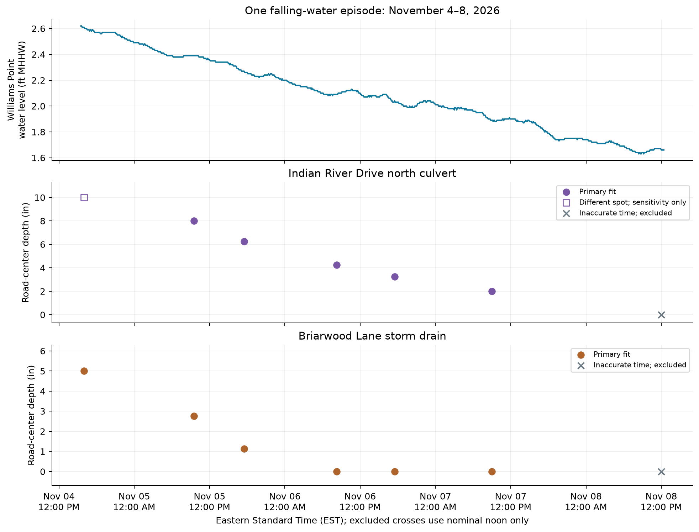
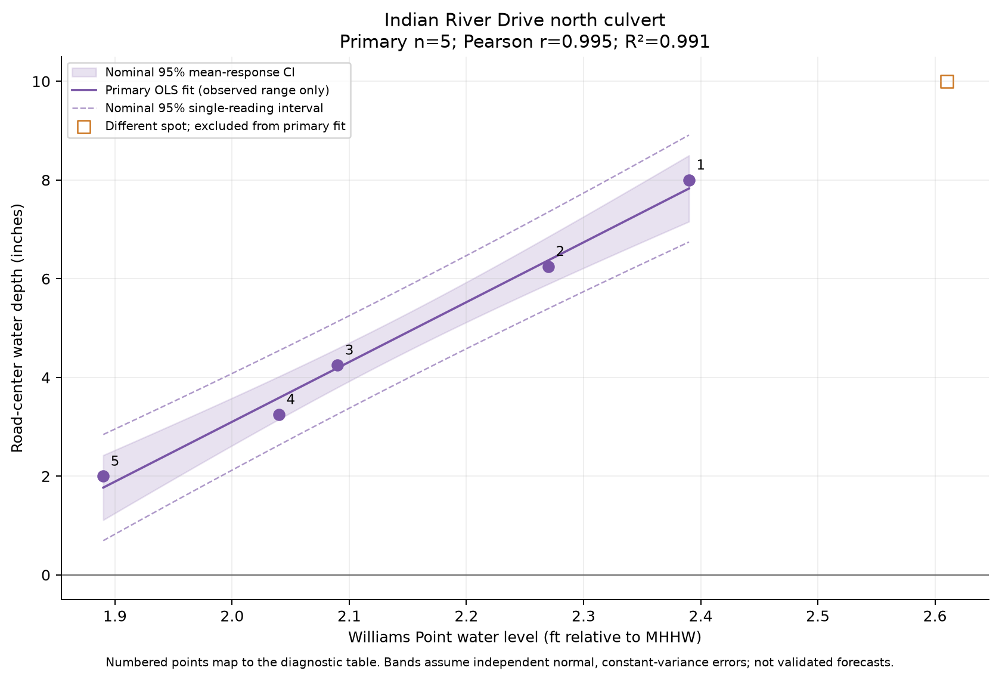
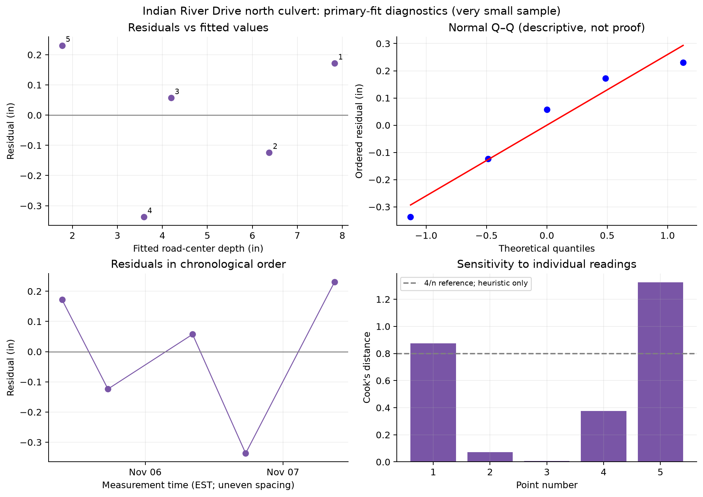
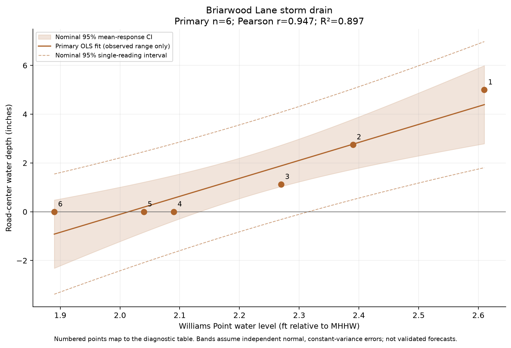
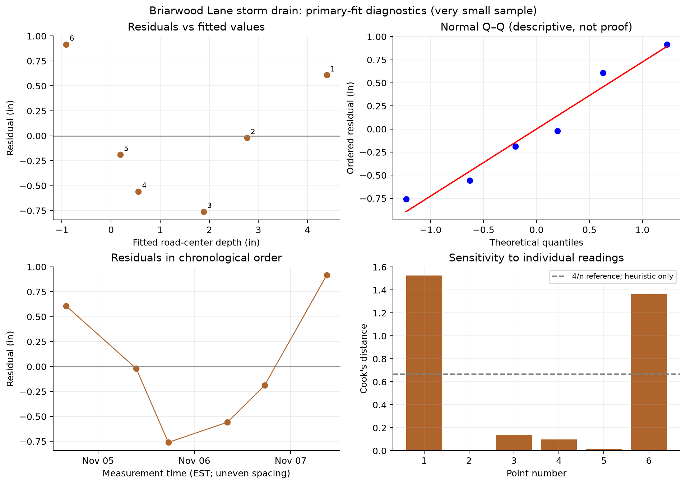
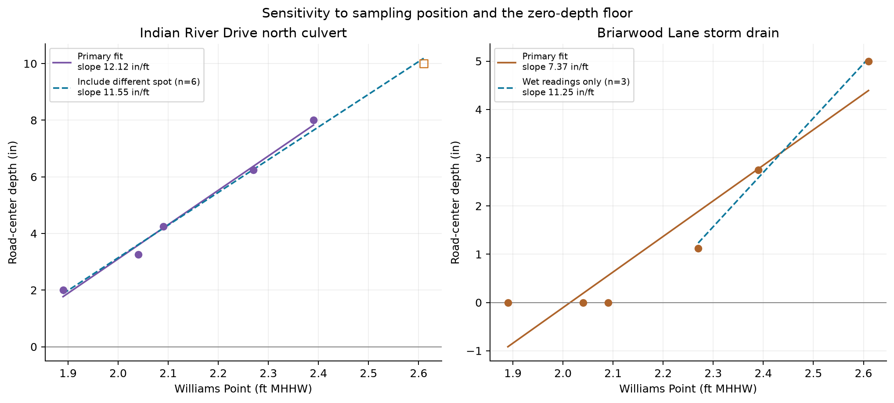

# Road-center depth and Williams Point water level

Retrospective exploratory analysis • prepared November 9, 2026 • local review copy

## What these observations show

The standard-position north-culvert readings track Williams Point closely during this one falling-water episode: **r=0.995, R²=0.991, n=5**. Briarwood also declines with the lagoon (**r=0.947, R²=0.897, n=6**), but its center reaches zero and then remains dry as the lagoon falls further. A straight line through all Briarwood readings therefore describes the wet-to-dry transition imperfectly. **These data support close tracking within this episode, especially at the north culvert; they do not establish a general hydraulic relationship, causation, lag, or forecasting accuracy.**

This analysis leaves the dashboard, deployment workflow, manual source records, and watchdog configuration unchanged. The research artifacts are separate from the dashboard build.

## Data, exclusions and pairing

- Road depths are inches above the local road center; deep-edge measurements are never substituted or added. Williams Point WIPF1 is feet relative to **MHHW**, verified from the downloaded header `station,valid[UTC],Water Height (MHHW)[ft]`.
- A small IEM/NWS HML observation snapshot contains **930** gauge points from Nov 04, 03:30 PM EST to Nov 08, 12:24 PM EST. Source header gives units/datum but no per-point quality flags or measurement-uncertainty estimates; archive observations may be provisional or revised.
- All 14 road records are preserved in the input snapshot. Both November 8 noon entries have inaccurate times and are **excluded from every regression, correlation, sensitivity fit and gauge pairing**, as requested. They appear only as crossed points at their nominal times in the time-series context plot.
- The November 4 north-culvert reading was made at a nearby, nonstandard spot. It is excluded from the primary north fit and included only in the explicitly labeled location-sensitivity fit. Every Briarwood timed reading is at its standard location.
- Primary pairing uses the nearest **actual** gauge observation within six minutes; ties select the earlier point. Five measurement times match exactly. November 6 at 8:15 a.m. EST matches the 8:12 a.m. gauge point (−3 minutes) at each road location. No gauge values are imputed in the primary fit.
- A separate sensitivity fit uses explicitly derived linear interpolation only when bracketing gauge observations are no more than 12 minutes apart; no extrapolation or interpolation across larger gaps is allowed.
- UTC-aware timestamps are retained in CSV/JSON; human-readable report and plot times use EST. The two vertical scales measure different quantities; fitting their association is not a datum conversion or an estimate of road elevation.

| Road measurement time (EST) | Location | Center (in) | Matched gauge (ft MHHW) | Offset (min) | Primary status |
|---|---|---:|---:|---:|---|
| Nov 04, 04:00 PM EST | Briarwood | 5 | 2.61 | 0 | Included |
| Nov 04, 04:00 PM EST | North culvert | 10 | 2.61 | 0 | Nonstandard road position; sensitivity analysis only |
| Nov 05, 09:30 AM EST | Briarwood | 2.75 | 2.39 | 0 | Included |
| Nov 05, 09:30 AM EST | North culvert | 8 | 2.39 | 0 | Included |
| Nov 05, 05:30 PM EST | Briarwood | 1.125 | 2.27 | 0 | Included |
| Nov 05, 05:30 PM EST | North culvert | 6.25 | 2.27 | 0 | Included |
| Nov 06, 08:15 AM EST | Briarwood | 0 | 2.09 | -3 | Included |
| Nov 06, 08:15 AM EST | North culvert | 4.25 | 2.09 | -3 | Included |
| Nov 06, 05:30 PM EST | Briarwood | 0 | 2.04 | 0 | Included |
| Nov 06, 05:30 PM EST | North culvert | 3.25 | 2.04 | 0 | Included |
| Nov 07, 09:00 AM EST | Briarwood | 0 | 1.89 | 0 | Included |
| Nov 07, 09:00 AM EST | North culvert | 2 | 1.89 | 0 | Included |
| Nov 08, 12:00 PM EST | Briarwood | 0 | not paired | — | Inaccurate time; user requested exclusion from regression |
| Nov 08, 12:00 PM EST | North culvert | 0 | not paired | — | Inaccurate time; user requested exclusion from regression |



Figure 1. Separate, aligned vertical scales avoid equating gauge height with road depth. Road dots are individual observations, not interpolated road-depth traces. The gray November 8 crosses have only nominal times and are excluded.

## Regression method

Each location is analyzed separately with ordinary least squares (OLS): **road depth (in) = intercept + slope × Williams Point height (ft MHHW) + residual**. The intercept is retained for standard reporting but lies outside the observed gauge range and must not be interpreted as road elevation or a flooding threshold. Reported 95% confidence intervals, coefficient t-tests and ANOVA F-tests are **nominal, conditional on independent, normally distributed, constant-variance errors and adequately measured gauge values**. They are not corrected for temporal dependence or multiple exploratory comparisons. HC3 intervals with residual-df Student-t reference are sensitivity checks for unequal variance; they do not correct serial dependence or rescue a five-point sample. RMSE uses sqrt(SSE/n); residual standard error uses sqrt(SSE/(n−2)). Leave-one-out (LOO) errors refit after removing each point; they assess within-episode sensitivity, not validation on a new storm.

## Indian River Drive north culvert

**Primary fit: depth = -21.1334 + 12.1177 × gauge height.** Calibration range is 1.89–2.39 ft MHHW, with depths 2–8 inches. There are 5 observations and 3 residual degrees of freedom.

| Coefficient | Estimate | SE | t | Nominal two-sided p | Nominal 95% CI | HC3 95% CI |
|---|---:|---:|---:|---:|---|---|
| Intercept (in) | -21.1334 | 1.4603 | -14.471 | 0.00071534 | [-25.781, -16.486] | [-29.539, -12.728] |
| Slope (in per ft) | 12.1177 | 0.6814 | 17.784 | 0.00038767 | [9.949, 14.286] | [8.259, 15.976] |

| Fit statistic | Value |
|---|---:|
| Pearson r | 0.9953 |
| Spearman rank rho (descriptive) | 1.0000 |
| R² | 0.9906 |
| Adjusted R² | 0.9875 |
| In-sample RMSE (in) | 0.2073 |
| Mean absolute error (in) | 0.1842 |
| Residual standard error (in) | 0.2677 |
| LOO RMSE (in) | 0.3921 |
| Pearson r nominal 95% Fisher-z CI | [0.927, 1.000] |

The Fisher-z correlation interval assumes independent bivariate-normal pairs and is only an approximation at this sample size; it does not account for the shared time trend.

| ANOVA source | df | Sum of squares (in²) | Mean square (in²) | F | Nominal p |
|---|---:|---:|---:|---:|---:|
| Regression | 1 | 22.66006 | 22.66006 | 316.271 | 0.00038767 |
| Residual | 3 | 0.21494 | 0.07165 | — | — |
| Total | 4 | 22.87500 | — | — | — |



The shaded band is the nominal 95% interval for the mean relation; dashed bands are nominal single-reading intervals under the same OLS assumptions. Bands and fitted line stop at the primary observed gauge range. Negative fitted values or lower bounds are left visible to reveal the linear model’s limitations; they are not negative measured depths or operational predictions.

### Individual-point diagnostics

| Point | Time (EST) | Fitted (in) | Residual (in) | Leverage | Cook’s D | LOO error (in) |
|---:|---|---:|---:|---:|---:|---:|
| 1 | Nov 05, 09:30 AM EST | 7.828 | 0.172 | 0.618 | 0.876 | 0.451 |
| 2 | Nov 05, 05:30 PM EST | 6.374 | -0.124 | 0.316 | 0.072 | -0.181 |
| 3 | Nov 06, 08:15 AM EST | 4.193 | 0.057 | 0.214 | 0.008 | 0.073 |
| 4 | Nov 06, 05:30 PM EST | 3.587 | -0.337 | 0.260 | 0.375 | -0.455 |
| 5 | Nov 07, 09:00 AM EST | 1.769 | 0.231 | 0.592 | 1.325 | 0.566 |



LOO slopes range from **11.376 to 13.020 in/ft**. The residual Shapiro–Wilk nominal p-value is 0.642; with n=5, failure to reject is not evidence of normal errors. Durbin–Watson is 2.782, reported descriptively only because observations are few and unevenly spaced. No meaningful heteroscedasticity or serial-correlation clearance can be obtained from these samples. The Cook’s-D 4/n line is an influence-screening heuristic, not an outlier test or a reason to discard an observation.

A nominal test of slope = 12 in/ft gives p=0.8739. Twelve is the unit-equivalent slope for equal changes in water level; this comparison does not establish direct hydraulic connection or equal absolute elevations.

## Briarwood Lane storm drain

**Primary fit: depth = -14.8512 + 7.3726 × gauge height.** Calibration range is 1.89–2.61 ft MHHW, with depths 0–5 inches. There are 6 observations and 4 residual degrees of freedom.

| Coefficient | Estimate | SE | t | Nominal two-sided p | Nominal 95% CI | HC3 95% CI |
|---|---:|---:|---:|---:|---|---|
| Intercept (in) | -14.8512 | 2.7852 | -5.332 | 0.0059562 | [-22.584, -7.118] | [-30.420, 0.717] |
| Slope (in per ft) | 7.3726 | 1.2502 | 5.897 | 0.0041358 | [3.902, 10.844] | [0.364, 14.382] |

| Fit statistic | Value |
|---|---:|
| Pearson r | 0.9470 |
| Spearman rank rho (descriptive) | 0.9411 |
| R² | 0.8968 |
| Adjusted R² | 0.8711 |
| In-sample RMSE (in) | 0.5966 |
| Mean absolute error (in) | 0.5085 |
| Residual standard error (in) | 0.7306 |
| LOO RMSE (in) | 1.0870 |
| Pearson r nominal 95% Fisher-z CI | [0.585, 0.994] |

The Fisher-z correlation interval assumes independent bivariate-normal pairs and is only an approximation at this sample size; it does not account for the shared time trend.

| ANOVA source | df | Sum of squares (in²) | Mean square (in²) | F | Nominal p |
|---|---:|---:|---:|---:|---:|
| Regression | 1 | 18.56523 | 18.56523 | 34.778 | 0.0041358 |
| Residual | 4 | 2.13529 | 0.53382 | — | — |
| Total | 5 | 20.70052 | — | — | — |



The shaded band is the nominal 95% interval for the mean relation; dashed bands are nominal single-reading intervals under the same OLS assumptions. Bands and fitted line stop at the primary observed gauge range. Negative fitted values or lower bounds are left visible to reveal the linear model’s limitations; they are not negative measured depths or operational predictions.

### Individual-point diagnostics

| Point | Time (EST) | Fitted (in) | Residual (in) | Leverage | Cook’s D | LOO error (in) |
|---:|---|---:|---:|---:|---:|---:|
| 1 | Nov 04, 04:00 PM EST | 4.391 | 0.609 | 0.623 | 1.526 | 1.616 |
| 2 | Nov 05, 09:30 AM EST | 2.769 | -0.019 | 0.256 | 0.000 | -0.026 |
| 3 | Nov 05, 05:30 PM EST | 1.885 | -0.760 | 0.176 | 0.140 | -0.921 |
| 4 | Nov 06, 08:15 AM EST | 0.558 | -0.558 | 0.212 | 0.100 | -0.708 |
| 5 | Nov 06, 05:30 PM EST | 0.189 | -0.189 | 0.256 | 0.015 | -0.254 |
| 6 | Nov 07, 09:00 AM EST | -0.917 | 0.917 | 0.476 | 1.365 | 1.750 |



LOO slopes range from **5.503 to 9.037 in/ft**. The residual Shapiro–Wilk nominal p-value is 0.698; with n=6, failure to reject is not evidence of normal errors. Durbin–Watson is 1.097, reported descriptively only because observations are few and unevenly spaced. No meaningful heteroscedasticity or serial-correlation clearance can be obtained from these samples. The Cook’s-D 4/n line is an influence-screening heuristic, not an outlier test or a reason to discard an observation.

A nominal test of slope = 12 in/ft gives p=0.02081. Twelve is the unit-equivalent slope for equal changes in water level; this comparison does not establish direct hydraulic connection or equal absolute elevations.

Three of the six primary Briarwood readings are zero. The all-reading test against slope 12 must not be interpreted as evidence against a 12 in/ft wet-state response: its single straight-line model does not represent the physical zero-depth floor.

## Sensitivity fits

| Model | n | Slope (in/ft) | Nominal slope 95% CI | R² | RMSE (in) | LOO RMSE (in) |
|---|---:|---:|---|---:|---:|---:|
| North: standard location, nearest actual gauge | 5 | 12.118 | [9.949, 14.286] | 0.9906 | 0.207 | 0.392 |
| North: include first nonstandard location | 6 | 11.547 | [10.231, 12.862] | 0.9933 | 0.226 | 0.357 |
| North: standard location, interpolated gauge | 5 | 12.118 | [9.949, 14.286] | 0.9906 | 0.207 | 0.392 |
| Briarwood: all accurately timed readings | 6 | 7.373 | [3.902, 10.844] | 0.8968 | 0.597 | 1.087 |
| Briarwood: positive depths only | 3 | 11.253 | [0.459, 22.047] | 0.9943 | 0.120 | 0.502 |
| Briarwood: interpolated gauge | 6 | 7.373 | [3.902, 10.844] | 0.8968 | 0.597 | 1.087 |



Each sensitivity line stops at its own observed gauge range. The wet-only Briarwood line is not extended into dry conditions; no breakpoint or flooding threshold is estimated.

The actual gauge observations bracketing the 8:15 a.m. road measurements both report 2.09 ft MHHW. Nearest-point and interpolated sensitivity fits are therefore identical for this snapshot.

Briarwood’s wet-only slope is 11.253 in/ft, with nominal 95% CI [0.459, 22.047] and only **three readings / one residual degree of freedom**. This conditional subset illustrates the zero-depth floor; it cannot establish a reliable wet-state calibration. A zero road depth is a physical floor: the lagoon can keep falling after the center becomes dry, while recorded road depth stays at zero. The zero points are genuine observations and remain in the primary Briarwood descriptive fit; they cannot identify an unobserved below-road water surface. No Tobit, breakpoint, flooding threshold, or nonnegative prediction model is fitted to this tiny series.

## Does the relationship remain after considering time?

| Location | Gauge-model R² | Time-only R² | Gauge vs elapsed-hours r | Change correlation | Rate-change correlation | Intervals |
|---|---:|---:|---:|---:|---:|---:|
| North standard | 0.9906 | 0.9681 | -0.9914 | 0.754 | 0.767 | 4 |
| Briarwood | 0.8968 | 0.8219 | -0.9933 | 0.674 | 0.882 | 5 |

Change correlation compares consecutive Δdepth and Δgauge; rate-change correlation divides each by its actual elapsed hours. These checks use only primary observations, retain chronological order and never bridge the censored November 8 records. Their much smaller sample sizes, shared endpoints and uneven intervals prevent treating them as independent replications or formal validation.

| Exploratory model: depth ~ gauge + elapsed hours | Gauge slope (in/ft) | Nominal 95% CI | Residual df | Gauge/time VIF |
|---|---:|---|---:|---:|
| North standard | 14.109 | [-12.629, 40.848] | 2 | 58.4 |
| Briarwood | 26.949 | [10.854, 43.044] | 3 | 74.4 |

Gauge height and elapsed time are strongly collinear in this single recession. The time-adjusted slopes are exploratory and unstable, with very few degrees of freedom. Neither a high unadjusted R² nor a time-adjusted coefficient can establish which physical processes caused the road-depth decline.

## Interpretation and limits

1. **North culvert:** the accurately timed, standard-position measurements provide strong descriptive evidence of close tracking during November 5–7. A slope near 12 in/ft is consistent with roughly equal changes in road depth and gauge level in this event, subject to the uncertainty above. The first nonstandard spot is supporting context, not interchangeable calibration data.
2. **Briarwood:** depths track the decline while wet, then stop at zero. The all-reading straight-line slope should not be interpreted as a constant hydraulic response across wet and dry states. Three wet readings are insufficient to establish the wet-only slope precisely.
3. **Small, selected, temporally related sample:** only one recession, no independent flood episodes, no rising limb and no controls for rain, wind, drainage or runoff. Both locations share sampling times and gauge values, so they are not independent event replications. Nominal p-values and intervals can overstate certainty when errors are temporally related.
4. **Measurement and matching uncertainty:** road-method precision, spatial repeatability and instrument errors are not quantified. Gauge values are reported to 0.01 ft (0.12 in), which is reporting resolution, not certified accuracy. Treating gauge values as error-free is an OLS assumption. The −3 minute match and interpolation sensitivity are explicit; no lag scan or data-selected matching is performed.
5. **No transfer to safety, thresholds or forecasts:** results do not identify road passability, a safe depth, a road elevation, or out-of-event performance. Residual/LOO errors and nominal single-reading intervals are retrospective diagnostics, not validated flood forecasts.
6. **What would strengthen the test:** collect accurately timed measurements at the same marked road centers through multiple independent rising and falling episodes, including repeated wet states at Briarwood. Record method/precision and paired deep-edge measurements separately. Assess performance by holding out entire events before considering any operational model.

## Reproduce and inspect

This directory is separate from `scripts/build.py`, `templates/` and the deployment workflow. Production remains standard-library only. The development-only dependencies are pinned in `requirements.txt`; no live download occurs when rerunning the analysis.

```bash
python3 -m venv /tmp/irl-road-analysis-env
/tmp/irl-road-analysis-env/bin/python -m pip install -r analyses/road_depth_vs_williams_point/requirements.txt
/tmp/irl-road-analysis-env/bin/python analyses/road_depth_vs_williams_point/analyze.py
/tmp/irl-road-analysis-env/bin/python -m unittest discover -s analyses/road_depth_vs_williams_point -p "test_*.py" -v
python3 -m unittest discover -s tests -v
```

- `inputs/manual_depths.csv`: unchanged snapshot of the 14 curated road readings.
- `inputs/wipf1.csv`: small, actual source response, not synthetic data or a bulk archive.
- `inputs/provenance.json`: exact request URL/bounds, retrieval UTC, verified header, input SHA-256 hashes and source repository commit.
- `paired_observations.csv`: all records, matching offsets, interpolation estimates, inclusion/exclusion decisions and original notes.
- `results.json`: full model statistics and per-point diagnostics, including nominal mean/single-reading intervals.
- `*_diagnostics.csv`: primary point-level residual, leverage, Cook’s distance and LOO errors.
- `figures/`: standalone PNG and SVG versions of all six figures.

Retrieved 2026-11-09T15:17:43.609195+00:00; source dashboard commit `502879d921afe61487cdad31f2603fab221d63a8`. Reruns verify cached input hashes and the parser hash recorded in provenance; source responses may change on later downloads. The analysis imports the existing validated dashboard parsers without modifying them.

### Verification for this review

All **61 existing dashboard unit tests** and **5 analysis-specific offline tests** passed. The analysis checks validate actual source-schema values, the −3 minute match, exclusion of both inaccurate-time records, nonstandard-position handling, bounded interpolation, no extrapolation or long-gap bridging, and timezone-aware inputs. Primary OLS coefficients, slope standard errors, nominal p-values, confidence intervals and R² were independently cross-checked against SciPy `linregress`; leave-one-out predictions were also recomputed independently. All six plots were visually inspected. These numerical/code checks do not validate a hydraulic mechanism or out-of-event predictive performance.

## Sources and statistical references

- [Exact IEM gauge request](https://mesonet.agron.iastate.edu/cgi-bin/request/hml.py?station=WIPF1&sts=2026-11-04T20%3A30Z&ets=2026-11-08T17%3A30Z&fmt=csv&kind=obs&tz=UTC); [IEM HML archive description](https://mesonet.agron.iastate.edu/request/hml.php). IEM archives processed NWS HML observations; the CSV establishes the displayed units and datum.
- [NIST: linear least-squares regression](https://www.itl.nist.gov/div898/handbook/pmd/section1/pmd141.htm): assumptions and sensitivity to influential observations.
- [NIST: residual analysis for nonconstant variation](https://www.itl.nist.gov/div898/handbook/pmd/section4/pmd442.htm): residual-versus-fitted diagnostics.
- [statsmodels OLS](https://www.statsmodels.org/stable/generated/statsmodels.regression.linear_model.OLS.html): statistical implementation; intercept supplied explicitly.
